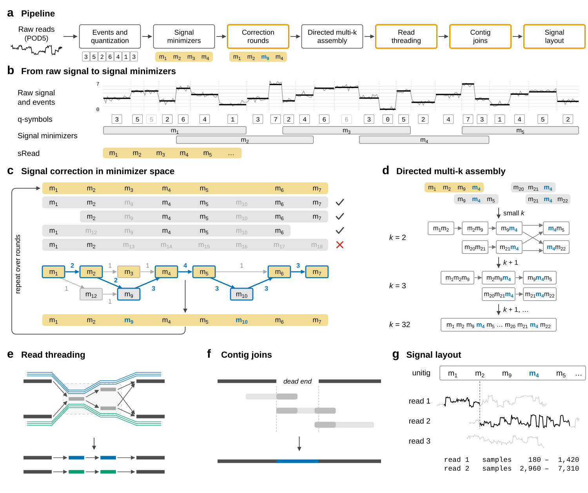

# SQUASH

**SQUASH assembles nanopore reads from their raw signal, without basecalling.** It takes POD5 files and gives an
assembly graph, each read's path through it, and each unitig's *signal layout*: which stretch of which read's raw
signal makes up each part of the unitig.

- **Input**: ONT R10.4.1 reads as POD5 (4 or 5 kHz). No basecalls, no reference.
- **Output**: an assembly graph of signal (GFA, no bases) and its signal layout. To get sequence, basecall the layout's
  read pieces ([docs/FAQ.md](docs/FAQ.md)).
- **Method**: nanoMDBG's correction and metaMDBG's minimizer-space de Bruijn graph, on signal instead of bases
  ([docs/METHOD.md](docs/METHOD.md)).
- **One choice to make**: `-x small` (genomes under 10 Mb) or `-x large` (10 Mb and more). Every other value
  defaults to the paper's and can be changed.
- **Reproducible**: the same POD5 files give the same outputs at any thread count; the paper's runs are reproduced byte
  for byte ([paper/](paper/README.md)).



*SQUASH from raw signal to signal layout: (a) the pipeline; (b) events, q-symbols and signal minimizers; (c)
correction rounds; (d) the directed multi-k assembly; (e) read threading; (f) contig joins; (g) the signal layout. As
in the paper's Figure 1 ([PDF](docs/overview.pdf)).*

Contents: [Install](#install) · [Run SQUASH on your reads](#run-squash-on-your-reads) ·
[Reproduce the paper](#reproduce-the-paper) · [Presets](#presets) · [Output](#output) · [Performance](#performance) ·
[Limitations](#limitations) · [Documentation](#documentation) · [Getting help](#getting-help) · [Cite](#cite)

## Install

SQUASH runs on Linux (x86-64). Run these blocks in a terminal, in order.

**1. Build tools** (Ubuntu; skip if you have `gcc`, `make`, `git` and `curl`):

```sh
sudo apt-get update && sudo apt-get install -y build-essential git curl pigz
```

**2. Rust**, at the version SQUASH pins (into your home folder):

```sh
curl --proto '=https' --tlsv1.2 -sSf https://sh.rustup.rs | sh -s -- -y --profile minimal --default-toolchain 1.95.0
source "$HOME/.cargo/env"
```

**3. SQUASH** (a few minutes):

```sh
git clone https://github.com/STORMgroup/SQUASH
cd SQUASH
make                                   # builds target/release/squash
./target/release/squash --version      # prints: squash 1.0.0 ...
./target/release/squash -h             # the main options (--help: every option)
```

**4. Optional: put `squash` on your `PATH`**, so that `squash` works in any folder as in the examples below (otherwise
type `/path/to/SQUASH/target/release/squash`):

```sh
make install PREFIX=$HOME/.local
echo 'export PATH="$HOME/.local/bin:$PATH"' >> ~/.bashrc && source ~/.bashrc
squash --version
```

**5. Optional: run the tests** (a few minutes):

```sh
make test
```

## Run SQUASH on your reads

**What you need**: the POD5 files of an R10.4.1 run (MinKNOW's `pod5/` folder), at least 40x coverage of the genome
(20x per strand: each strand assembles on its own).

Only if your reads are FAST5 files, convert them to POD5 first:

```sh
pip install pod5==0.3.39
pod5 convert fast5 --output reads.pod5 fast5_folder/*.fast5
```

**Assemble.** Give the preset for your genome's size (`-x`), an output folder (`-o`) and the POD5 files or their
folder. Run the line that fits your genome:

- a genome under 10 Mb (a bacterium):

  ```sh
  squash -x small -o my_assembly reads.pod5
  ```

- a genome of 10 Mb or more (a eukaryote):

  ```sh
  squash -x large -o my_assembly pod5_folder/
  ```

SQUASH uses every core (`-t N` for fewer). `my_assembly/squash.log` shows the progress; a stopped run continues with
the same command plus `--resume`.

**Change a parameter.** Every value the preset sets can be changed. To see the values a run would use (without
running it):

```sh
squash -x large -o my_assembly --dry-run pod5_folder/
```

To list every option (`squash -h`: the main ones only):

```sh
squash --help
```

Then add the ones to change, for example 20 correction rounds instead of 16 and tips removed up to 30 kb instead of
50 kb:

```sh
squash -x large --rounds 20 --tip-max 30k -o my_assembly_r20 pod5_folder/
```

[docs/USAGE.md](docs/USAGE.md) explains every option. The results are in the output folder ([Output](#output)).

## Reproduce the paper

[paper/](paper/README.md) rebuilds the paper's read sets from their public deposits, runs SQUASH as the paper did and
checks that the outputs are the paper's, byte for byte. From the `SQUASH` folder:

1. Only if you do not have conda: install Miniforge (into your home folder):

   ```sh
   curl -L -O https://github.com/conda-forge/miniforge/releases/download/26.9.4-1/Miniforge3-26.9.4-1-Linux-x86_64.sh
   bash Miniforge3-26.9.4-1-Linux-x86_64.sh -b -p $HOME/miniforge3
   source $HOME/miniforge3/bin/activate
   ```

2. The Python packages of `paper/` (once; in a new terminal, `conda activate squash-paper` again):

   ```sh
   conda env create -f paper/environment.yml
   conda activate squash-paper
   ```

3. One dataset, C. jejuni: a 42-GB download (about an hour; ~90 GB of free disk), then a few minutes:

   ```sh
   make -C paper check SET=cjk60_both60
   ```

It ends with `check.sh: cjk60_both60: all 6 files equal the paper's`. `SET=main` does the paper's eight datasets
(~4.3 TB of downloads); [paper/README.md](paper/README.md) also runs the other tools, the evaluation and the tables.

## Presets

| | `-x small` | `-x large` |
|---|---|---|
| Genomes | under 10 Mb | 10 Mb and over |
| Correction rounds | 12 | 16 |
| Partners of partners, re-search changed reads only (from round 2) | off | on |
| Correct only the changed segments (from round 8) | off | on |
| Q-symbol alignment check of correction partners | off | on |

## Output

| File | What |
|---|---|
| `assembly_graph.gfa` | the final graph (k = 32): one segment per unitig (signal tokens, no bases), links, circular unitigs as self-links |
| `assembly_info.tsv` | one row per unitig: length in tokens and approximate bp, abundance, circularity |
| `layout.tsv.gz` | the signal layout: per unitig, the read pieces that tile it, with their POD5 sample spans |
| `read_paths.tsv.gz` | each read's path through the graph (its pieces on unitigs) |
| `joins.tsv`, `stats.tsv` | the contig joins made; counts per step |
| `params.tsv`, `squash.log` | every value of the run; the run's log |

Each region of the genome appears once per strand. There is no FASTA: to get bases, basecall the read pieces of a
unitig's layout and join them in layout order ([docs/OUTPUTS.md](docs/OUTPUTS.md), [docs/FAQ.md](docs/FAQ.md)).
To look at the graph, open `assembly_graph.gfa` in [Bandage](https://rrwick.github.io/Bandage/) (its node lengths are
in tokens, not bases).

## Performance

The paper's datasets with 64 threads on an AMD EPYC 7502: wall time and peak memory, as in the paper.

| Dataset | Genome size | Coverage per strand | Preset | Time (h:mm:ss) | Memory (GB) |
|---|---|---|---|---|---|
| *E. coli* ATCC 25922 | 5.1 Mb | 50x | small | 0:05:31 | 3.1 |
| *C. jejuni* ATCC 33560 | 1.8 Mb | 50x | small | 0:01:33 | 1.5 |
| *V. parahaemolyticus* ATCC 17802 | 5.1 Mb | 50x | small | 0:05:06 | 3.8 |
| *S. dysgalactiae* UT9728 | 2.1 Mb | 50x | small | 0:01:57 | 2.0 |
| *A. rabiei* ME14 | 40.8 Mb | 50x | large | 1:11:03 | 11.8 |
| Human HG002, chr13 q-arm | 96.1 Mb | 30x | large | 1:11:51 | 14.1 |
| *D. melanogaster* ISO1 | 137.5 Mb | 50x | large | 4:15:56 | 28.2 |
| *A. thaliana* Col-0 | 142.5 Mb | 30x | large | 4:50:55 | 24.2 |

While it runs, SQUASH needs about as much free disk in the output folder as the POD5s take (or in `--tmp-dir`).

## Limitations

- R10.4.1 reads only (POD5, 4 or 5 kHz); other chemistries are untested.
- At least 20x coverage per strand (40x of the genome); below that the graph fragments.
- No bases: the output is a graph of signal, and sequence needs basecalling the layout's read pieces.
- Each strand is assembled on its own, so the graph holds each region twice.
- Tested on bacteria and on genomes up to 143 Mb; larger genomes and metagenomes are untested.

## Documentation

| | |
|---|---|
| [docs/USAGE.md](docs/USAGE.md) | examples, the input, every option and its default under each preset |
| [docs/OUTPUTS.md](docs/OUTPUTS.md) | every output file, column by column; the work folder |
| [docs/METHOD.md](docs/METHOD.md) | the method in one page, and where each step is in the code |
| [docs/FAQ.md](docs/FAQ.md) | which preset, how much coverage, why two copies of each region, how to get bases |
| [paper/README.md](paper/README.md) | reproducing the paper: download the public data, rebuild each dataset, run, compare |
| [NEWS.md](NEWS.md) | release notes |

## Getting help

Open an [issue](https://github.com/STORMgroup/SQUASH/issues) with the command you ran, `out/squash.log` and
`out/params.tsv`; for a failed step, also its log in `out/work/logs/`.

## Cite

Quang Ngo, Ulysse McConnell, Can Firtina. *SQUASH: Assembling raw nanopore signals with minimizer-space de Bruijn
graphs.* In preparation, 2026 ([CITATION.cff](CITATION.cff)).

SQUASH builds on rust-mdbg (Ekim, Berger, Chikhi; its code base and MIT notice are kept), on nanoMDBG and metaMDBG
(Benoit et al.), whose correction and graph rules the method follows, and on RawHash2 (Firtina et al.), whose event
detector it ports.

## Licence

MIT ([LICENSE](LICENSE)).
